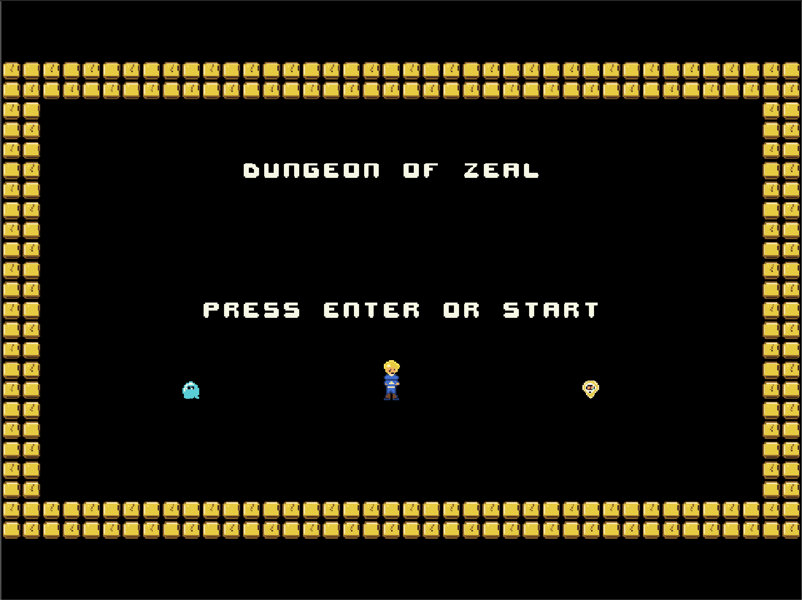
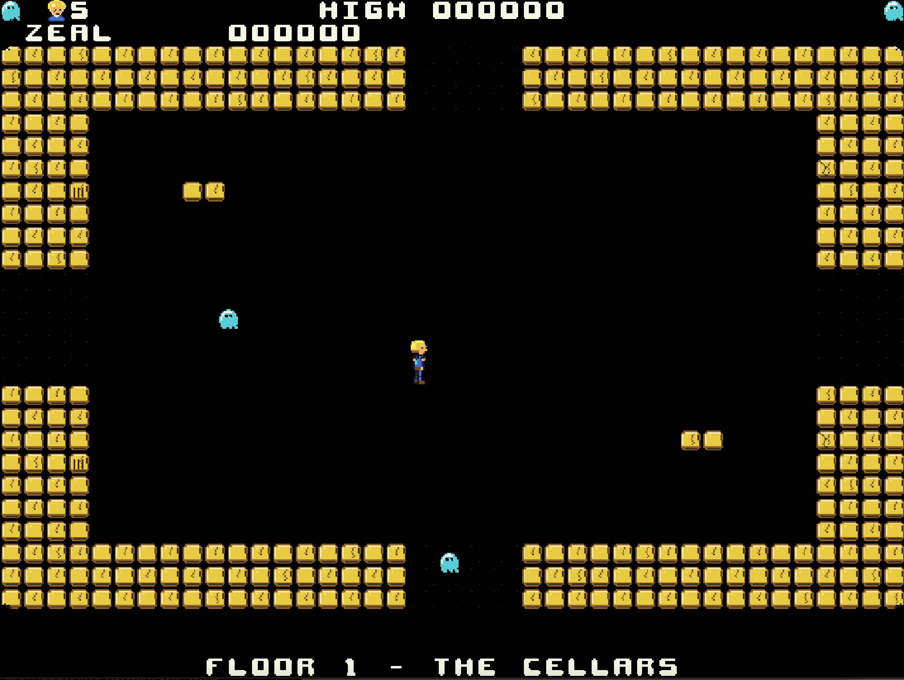
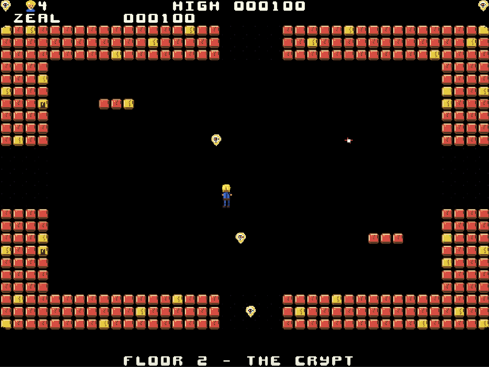

# zeal-dungeon-of-zeal

Dungeon Of Zeal is an action exploration game for the Zeal 8-bit Computer, with **8 floors**, **72 rooms** and a final encounter.

It runs at **640×480 @8bpp** with the Zeal Video Board.

## Screenshots

| Title Screen | Floor 1| Floor 2 |
| - | - | - |
|  |  |  |

<!-- Keep the screenshots folder in the repository alongside this README. -->

## Rules

- Explore each floor's nine connected rooms. Shoot enemies to earn points.
- Transport: with the key, step in and press Enter to go up one floor, or Down then Enter to go down one floor (Space or Z steps out). Without the key, or on floor 8, it sends you to a random floor from 1 to 4 using one transport charge; you start with two, and with none left you stay where you are.
- You have a limited number of shots. Collect piles and pictures for more.
- Carry piles to chests on the final floor and use a key to exchange them. Reach the final figure with no piles remaining to finish the encounter.
- Start with five lives. Earn an extra life every 10,000 points, up to nine. The ending offers a harder repeat with more visible enemies.

## Controls

- `ENTER`: start, pause/resume, or go in the transport.
- Arrow keys: move; in the transport with the key, Down chooses one floor down and Up one floor up.
- `SPACE` or `Z`: fire while stationary; in the transport, step out.
- `ESC` (or Select on the pad): return to ZealOS.

## Game Flow

1. Press Enter at the title and explore the starting floor.
2. Find the key, shots and transport; in the transport, press Enter to go up one floor, or Down then Enter to go down.
3. Explore all eight floors, exchanging carried piles at a chest on the last floor.
4. Reach the final encounter, then press Enter for a harder repeat.

## Build

Build from the project folder with the existing ZDE environment:

```sh
zde cmake
```
## Attribution

Font, copied from MiniGolf's cells 16–41 and 6–15:

- Author: Zingot Games
- License: CC-BY 4.0
- Source: https://opengameart.org/content/bitmap-font-pack
- A few changes to the original assets have been made including the color palette. Dungeon Of Zeal maps the font ink to its existing off-white text colour and black/background to transparency.

The project-wide licence remains unassigned; the font's CC-BY 4.0 attribution is retained independently.

Edit rooms in `assets/dungeon.tmx`; the palette and named tile/animation slices live in `assets/zdungeon.aseprite`.
