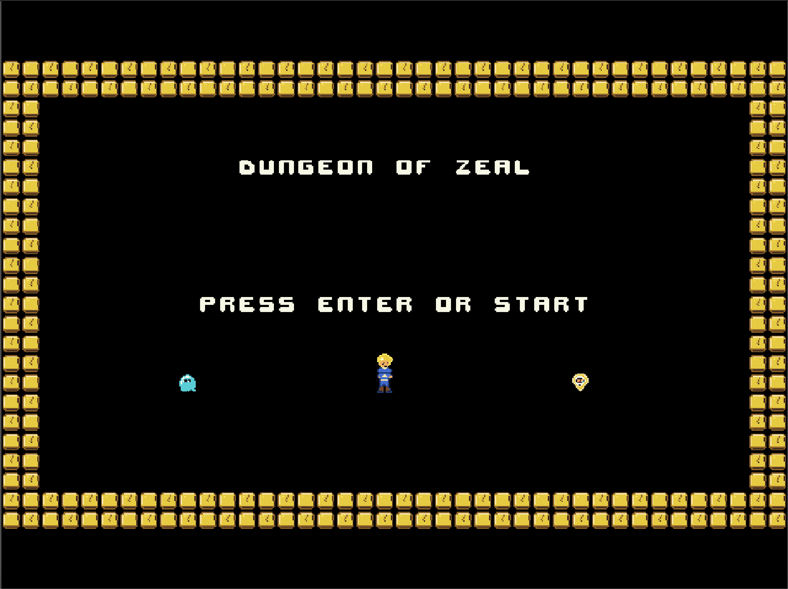
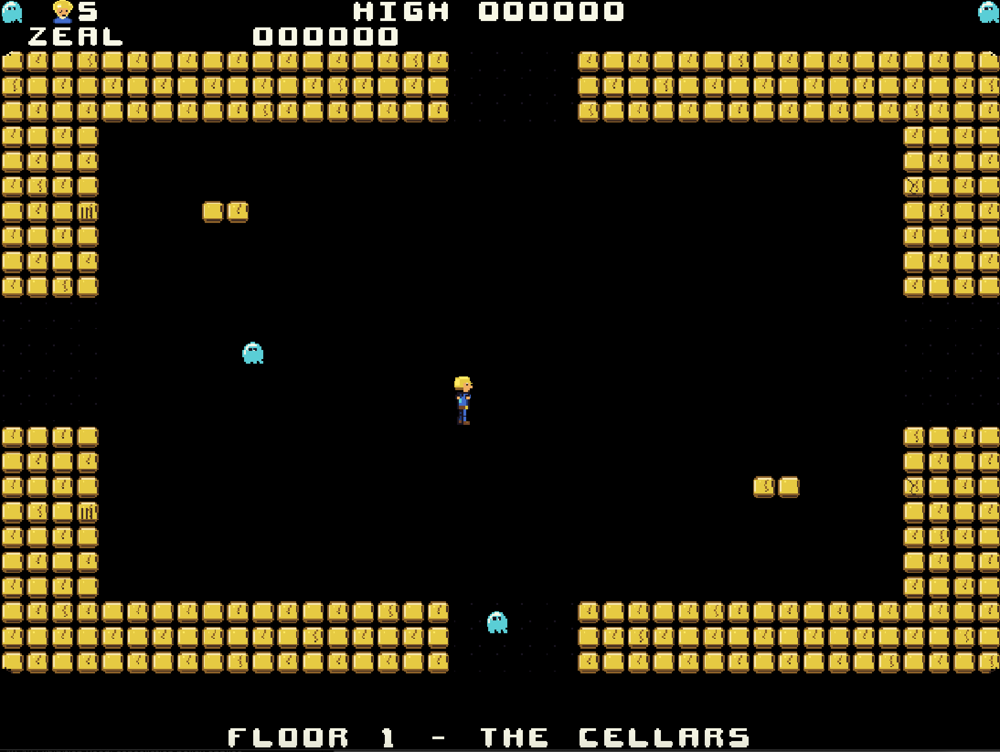
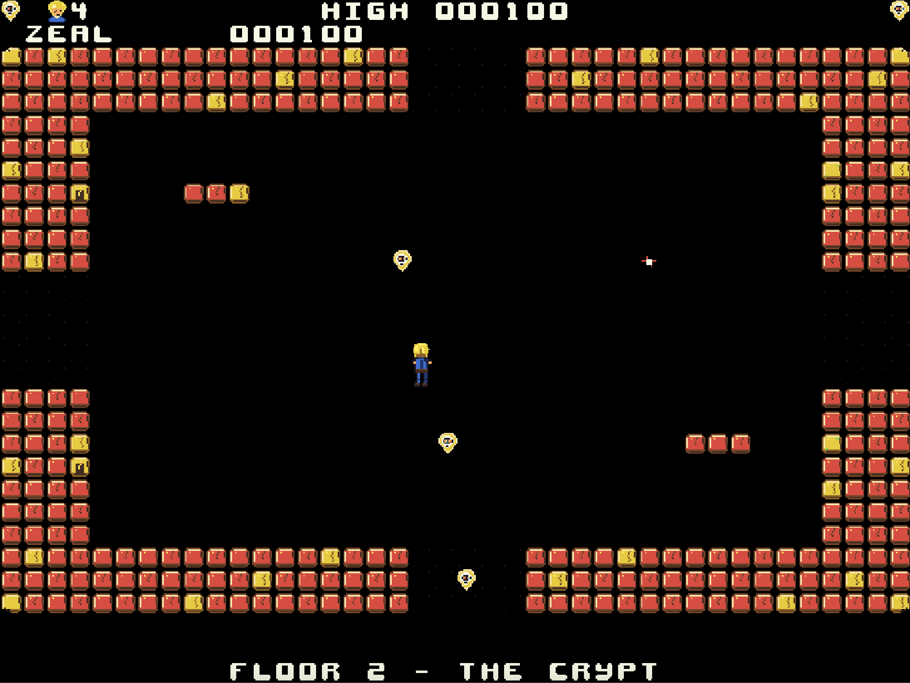

# zeal-dungeon-of-zeal

Dungeon Of Zeal is an action exploration game for the Zeal 8-bit Computer, with **8 floors**, **72 rooms** and a final encounter.

It runs at **640×480 @8bpp** with the Zeal Video Board.

## Screenshots

| Title Screen | Floor 1| Floor 2 |
| - | - | - |
|  |  |  |

<!-- Keep the screenshots folder in the repository alongside this README. -->

## Rules

- Explore each floor's nine connected rooms. Shoot enemies to earn points.
- You have a limited number of shots. Collect piles and pictures for more.
- Carry piles to chests on the final floor and use a key to exchange them. Reach the final figure with no piles remaining to finish the encounter.
- Start with five lives. Earn an extra life every 10,000 points, up to nine. The ending offers a harder repeat with more visible enemies.

## The transport

- Step into the transport and it starts by itself; the trip takes about a second.
- **With the key:** hold **Down** from the moment you are inside until you arrive to go **down one floor**. Anything else – holding Up, or pressing nothing – takes you **up one floor**.
- **Without the key, or on floor 8:** it sends you to a random floor from 1 to 4 using one transport charge. You start with two; with none left, you stay where you are.
- The key is used up by the trip, so you need to find the key again on the new floor.

## Controls

| Action | Keyboard | Joypad |
| - | - | - |
| Move | Arrow keys | D-pad |
| Fire (while stationary) | `SPACE` or `Z` | B |
| Start, pause/resume | `ENTER` | Start |
| Transport: go down | hold Down | hold Down |
| Return to ZealOS | `ESC` | Select |

The keyboard and the joypad can be used together.

## Game Flow

1. Press Enter (or Start) at the title and explore the starting floor.
2. Find the key, shots and transport; step into the transport to go up one floor, or hold Down inside it to go down.
3. Explore all eight floors, exchanging carried piles at a chest on the last floor.
4. Reach the final encounter, then press Enter (or Start) for a harder repeat.

## Build

Build from the project folder with the existing ZDE environment:

```sh
zde cmake
```
## Attribution

Font, copied from MiniGolf's cells 16–41 and 6–15:

- Author: Zingot Games
- License: CC-BY 4.0
- Source: https://opengameart.org/content/bitmap-font-pack
- A few changes to the original assets have been made including the color palette. Dungeon Of Zeal maps the font ink to its existing off-white text colour and black/background to transparency.

The project-wide licence remains unassigned; the font's CC-BY 4.0 attribution is retained independently.

Edit rooms in `assets/dungeon.tmx`; the palette and named tile/animation slices live in `assets/zdungeon.aseprite`.

   ## Credits

   - @harlock74 – design and development
   - @zoul0813 – playtesting and general code optimization
